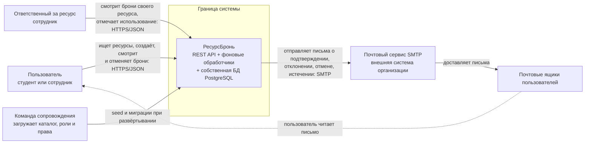
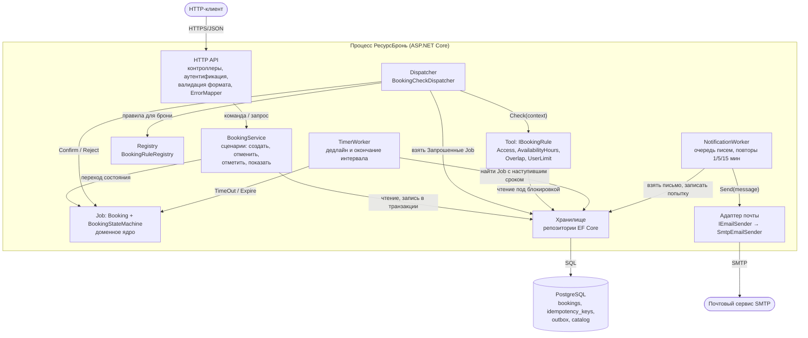

# Архитектура РесурсБрони

Документ описывает систему на двух уровнях: контекст (кто и что вокруг системы) и компоненты (что внутри).
Требования и сценарии — в [requirements.md](requirements.md), состояния Job — в [job-states.md](job-states.md),
контракт API — в [api/openapi.yaml](api/openapi.yaml), контракт Tool — в [tool-contract.md](tool-contract.md),
решения — в [adr/](adr/).

Сквозная цепочка проекта: **запрос → Job → Dispatcher → Registry → Tool → ToolResult**. В РесурсБрони Job — это бронь
одного ресурса на интервал, Tool — правило проверки брони (`IBookingRule`), ToolResult — `RuleResult`.

## Контекст (C4, уровень Context)

**Что показывают стрелки:** вызовы и потоки данных во время работы — кто инициирует взаимодействие и по какому протоколу.
Сплошная стрелка — система или человек обращается к другой стороне, пунктир — человек получает информацию вне системы.
PostgreSQL на этом уровне — часть системы: базой владеет только РесурсБронь, другие системы в неё не ходят.
Единственная внешняя зависимость во время работы — почтовый сервис. Каталог ресурсов, часы доступности и роли
заданы заранее (README), поэтому команда сопровождения работает с системой только при развёртывании.

Аутентификация: входной слой принимает bearer-токен (JWT), подписанный ключом сервиса. В первом семестре токены
тестовых пользователей выпускает команда seed при запуске; вход через систему учётных записей организации — за рамками
первого семестра.

| Участник или система | Роль по отношению к РесурсБрони |
|---|---|
| Пользователь | Ищет свободные ресурсы, создаёт брони (Job), смотрит свои брони, отменяет подтверждённые |
| Ответственный за ресурс | Видит подтверждённые брони закреплённых за ним ресурсов, отмечает использование |
| Команда сопровождения | Загружает каталог, часы доступности, пользователей и права через seed и миграции |
| Почтовый сервис SMTP | Принимает письма для доставки. Его сбой не влияет на статус брони |

## Компоненты

Вся система — один процесс ASP.NET Core: HTTP-слой и фоновые обработчики (`BackgroundService`) работают в одном
приложении и общаются через PostgreSQL. Почему без брокера сообщений — [ADR-0002](adr/0002-postgresql-queue-and-timers.md).

**Что показывают стрелки:** вызовы во время работы — кто кого вызывает, подпись говорит, зачем. Направление вызова здесь
совпадает с направлением зависимости кода, с двумя оговорками:

- Dispatcher зависит только от интерфейса `IBookingRule` и от Registry, а не от конкретных правил. Новое правило
  добавляется регистрацией в Registry без правки Dispatcher.
- Доменное ядро (Job) ни от чего не зависит: не знает про HTTP, EF Core и SMTP. Хранилище и адаптер почты
  реализуют интерфейсы, объявленные ядром и сервисом (`IBookingRepository`, `IEmailSender`), то есть
  зависимость кода направлена от инфраструктуры к ядру.

| Компонент | За что отвечает | Что скрывает от соседей |
|---|---|---|
| HTTP API | Принимает HTTP, проверяет токен, формат тела, типы полей и лимит размера; переводит исключения в единый формат ошибок | HTTP, JSON, коды статусов и формат токена. Ядро и сервис получают готовые команды и не знают про HTTP |
| BookingService | Выполняет сценарии S1–S5: создание Job с ключом повтора, отмена, отметка, списки; проверяет владельца и ответственного | Порядок шагов внутри транзакции и правила повтора: API видит только результат команды |
| Job (Booking + BookingStateMachine) | Хранит состояние брони и разрешает только переходы из [job-states.md](job-states.md) с их временными условиями | Таблицу переходов. Снаружи доступны методы `Confirm`, `Reject`, `TimeOut`, `Cancel`, `CheckIn`, `Expire`, недопустимый переход даёт `InvalidTransitionException` |
| Dispatcher | Берёт Job «Запрошена», получает у Registry правила, запускает их по порядку, фиксирует подтверждение или отклонение | Какие правила существуют и как повторяется проверка при временной ошибке |
| Registry | Хранит зарегистрированные `IBookingRule` и отдаёт их в порядке выполнения | Способ регистрации (DI-контейнер) и список конкретных классов |
| Tool (`IBookingRule`) | Одна бизнес-проверка брони: права, часы доступности, пересечения, лимит | Как именно проверяет: SQL-запросы, расписание, формулу лимита. Наружу — только `RuleResult` с кодом причины |
| TimerWorker | Раз в несколько секунд находит Job с наступившим дедлайном или окончанием и выполняет переход; после перезапуска догоняет пропущенные | Способ планирования (опрос таблицы, а не таймеры в памяти) и догон после простоя |
| NotificationWorker | Забирает письма из очереди, отправляет через адаптер, планирует повторы через 1, 5, 15 минут, фиксирует недоставку | Расписание повторов и учёт попыток. Статус брони от него не зависит |
| Хранилище | Репозитории EF Core: Job, ключи повтора, очередь писем, каталог; условные обновления и блокировки | SQL, схему таблиц, блокировки `SELECT … FOR UPDATE`, время сервера БД как источник «сейчас» |
| Адаптер почты | Отправляет одно письмо через SMTP с таймаутом и классифицирует ошибку как временную или постоянную | Протокол SMTP, библиотеку (MailKit), адрес и учётные данные сервера |

## Адаптер почты: поведение при сбоях SMTP

Адаптер — единственное место, которое знает про SMTP. Наружу он возвращает один из трёх исходов, а NotificationWorker
решает по нему, что делать с письмом. Статус брони от исхода не зависит: переход уже сохранён до отправки.

| Что произошло | Исход адаптера | Что делает NotificationWorker |
|---|---|---|
| Сервер принял письмо (`250`) | `Sent` | Отмечает письмо отправленным |
| Нет соединения, сервер молчит дольше 10 секунд (таймаут на попытку), ответ `4xx`, обрыв соединения | `TemporaryFailure` | Планирует повтор через 1, 5, 15 минут; после третьего повтора фиксирует недоставку (E6, E11) |
| Ответ `5xx` (адрес не существует, письмо отвергнуто), ответ не по протоколу SMTP | `PermanentFailure` | Сразу фиксирует недоставку без повторов, пишет в лог `email_rejected` |

Письма отправляются по одному, с таймаутом на попытку, поэтому зависший сервер задерживает только очередь писем,
а не API и не проверку броней. Пользователь видит статус брони через API в любом случае (S5).

## Источник времени

Источник времени для переходов — время сервера PostgreSQL на момент сохранения (`clock_timestamp()` в условном `UPDATE`), а не часы
экземпляра приложения. Так проверка «момент сохранения строго раньше начала интервала» одинакова для всех экземпляров.
