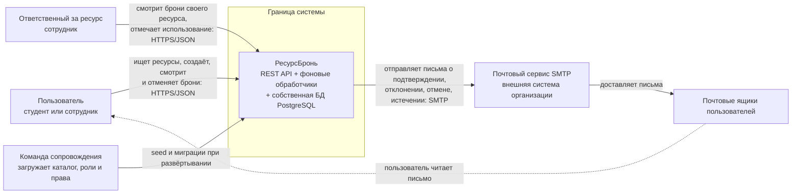
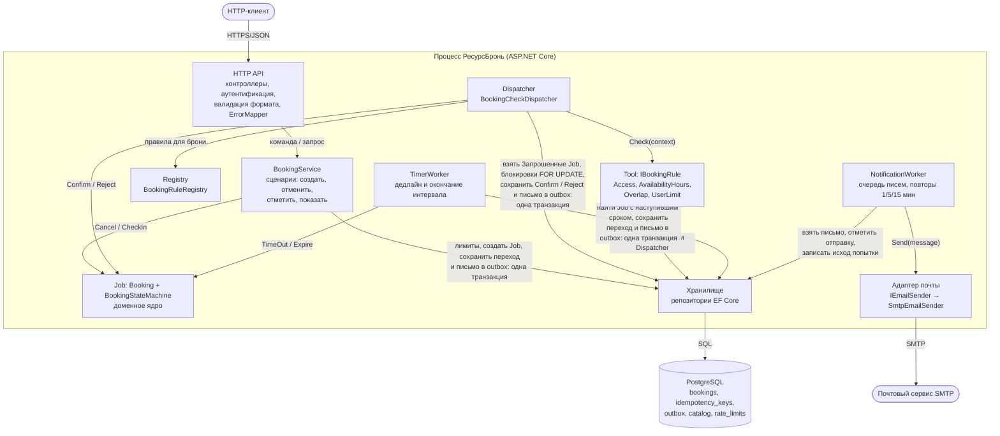

# Архитектура РесурсБрони

Документ описывает систему на двух уровнях: контекст (кто и что вокруг системы) и компоненты (что внутри).
Требования и сценарии — в [requirements.md](requirements.md), состояния Job — в [job-states.md](job-states.md),
контракт API — в [api/openapi.yaml](api/openapi.yaml), контракт Tool — в [tool-contract.md](tool-contract.md),
решения — в [adr/](adr/).

Сквозная цепочка проекта: **запрос → Job → Dispatcher → Registry → Tool → ToolResult**. В РесурсБрони Job — это бронь
одного ресурса на интервал, Tool — правило проверки брони (`IBookingRule`), ToolResult — `RuleResult`.

## Контекст (C4, уровень Context)

**Что показывают стрелки:** вызовы и потоки данных во время работы — кто инициирует взаимодействие и по какому протоколу.
Сплошная стрелка — система или человек обращается к другой стороне, пунктир — человек получает информацию вне системы.
PostgreSQL на этом уровне — часть системы: базой владеет только РесурсБронь, другие системы в неё не ходят.
Единственная внешняя зависимость во время работы — почтовый сервис. Каталог ресурсов, часы доступности и роли
заданы заранее (README), поэтому команда сопровождения работает с системой только при развёртывании.

Аутентификация: входной слой принимает bearer-токен (JWT), подписанный ключом сервиса. В первом семестре токены
тестовых пользователей выпускает команда seed при запуске; вход через систему учётных записей организации — за рамками
первого семестра.

| Участник или система | Роль по отношению к РесурсБрони |
|---|---|
| Пользователь | Ищет свободные ресурсы, создаёт брони (Job), смотрит свои брони, отменяет подтверждённые |
| Ответственный за ресурс | Видит подтверждённые брони закреплённых за ним ресурсов, отмечает использование |
| Команда сопровождения | Загружает каталог, часы доступности, пользователей и права через seed и миграции |
| Почтовый сервис SMTP | Принимает письма для доставки. Его сбой не влияет на статус брони |

## Компоненты

Вся система — один процесс ASP.NET Core: HTTP-слой и фоновые обработчики (`BackgroundService`) работают в одном
приложении и общаются через PostgreSQL. Почему без брокера сообщений — [ADR-0002](adr/0002-postgresql-queue-and-timers.md).

**Что показывают стрелки:** вызовы во время работы — кто кого вызывает, подпись говорит, зачем. Стрелки не показывают
направление зависимости кода, и для части стрелок оно обратное:

- **Вызовы к Хранилищу и адаптеру почты** (`svc → store`, `disp → store`, `tools → store`, `timers → store`,
  `notif → store`, `notif → mail`): вызывающий компонент знает только интерфейс, объявленный ядром или сервисом
  (`IBookingRepository` и другие репозитории, `IEmailSender`), а Хранилище и адаптер почты его реализуют. Вызов идёт
  к инфраструктуре, а зависимость кода — от инфраструктуры к ядру. Поэтому доменное ядро (Job) ни от чего не
  зависит и не знает про HTTP, EF Core и SMTP.
- **Остальные вызовы** (`client → api → svc`, вызовы Job, Registry и правил): направление вызова совпадает с
  направлением зависимости. Dispatcher при этом зависит только от интерфейса `IBookingRule` и от Registry, а не от
  конкретных правил: новое правило добавляется регистрацией в Registry без правки Dispatcher.

**Кто сохраняет переход.** Job только решает, допустим ли переход из текущего состояния. Сохраняет его тот, кто
вызвал метод Job: BookingService (`Cancel`, `CheckIn`), Dispatcher (`Confirm`, `Reject`) или TimerWorker (`TimeOut`,
`Expire`). Каждый пишет новый статус условным `UPDATE` и ставит письмо в `outbox` в той же транзакции. Блокировки
берёт Dispatcher: открывает транзакцию, блокирует строки через `SELECT … FOR UPDATE` (состав блокировок — в
[tool-contract.md](tool-contract.md)) и передаёт её правилам. Правила сами блокировок не берут, а только читают
данные в транзакции Dispatcher.

| Компонент | За что отвечает | Что скрывает от соседей |
|---|---|---|
| HTTP API | Принимает HTTP, проверяет токен, формат тела, типы полей и лимит размера; переводит исключения в единый формат ошибок, для `429 rate_limited` ставит заголовок `Retry-After` | HTTP, JSON, коды статусов и формат токена. Ядро и сервис получают готовые команды и не знают про HTTP |
| BookingService | Выполняет сценарии S1–S5: создание Job с ключом повтора, отмена, отметка, списки; проверяет владельца и ответственного. Проверяет лимиты создания: не больше 30 запросов `POST /api/bookings` в минуту на пользователя (`rate_limited`, счётчик в таблице `rate_limits`, общий для всех экземпляров) и не больше 5 броней `requested` на пользователя (`too_many_pending_requests`). Лимит `requested` считается в транзакции создания под блокировкой строки пользователя, чтобы два одновременных запроса не прошли оба; повтор с прежним ключом возвращает существующий Job и в этот лимит не входит | Порядок шагов внутри транзакции, правила повтора и учёт лимитов: API видит только результат команды |
| Job (Booking + BookingStateMachine) | Хранит состояние брони и разрешает только переходы из [job-states.md](job-states.md) по текущему состоянию. Временные условия переходов («строго раньше начала», «наступил дедлайн», «прошло окончание») Job не проверяет: их проверяет одно место — условный `UPDATE` в Хранилище по времени БД (см. «Источник времени») | Таблицу переходов. Снаружи доступны методы `Confirm`, `Reject`, `TimeOut`, `Cancel`, `CheckIn`, `Expire`, недопустимый переход даёт `InvalidTransitionException` |
| Dispatcher | Берёт Job «Запрошена», открывает транзакцию и берёт блокировки, получает у Registry правила, запускает их по порядку в этой транзакции и сохраняет подтверждение или отклонение вместе с письмом в `outbox` | Какие правила существуют, какие строки блокируются и как повторяется проверка при временной ошибке |
| Registry | Хранит зарегистрированные `IBookingRule` и отдаёт их в порядке выполнения | Способ регистрации (DI-контейнер) и список конкретных классов |
| Tool (`IBookingRule`) | Одна бизнес-проверка брони: права, часы доступности, пересечения, лимит. Читает данные в транзакции Dispatcher, сам блокировок не берёт и ничего не пишет | Как именно проверяет: SQL-запросы, расписание, формулу лимита. Наружу — только `RuleResult` с кодом причины |
| TimerWorker | Раз в несколько секунд находит по времени БД Job с наступившим дедлайном или окончанием и сохраняет переход вместе с письмом в `outbox`; после перезапуска догоняет пропущенные | Способ планирования (опрос таблицы, а не таймеры в памяти) и догон после простоя |
| NotificationWorker | Забирает письма из очереди, отправляет через адаптер, планирует повторы через 1, 5, 15 минут, фиксирует недоставку, приостанавливает отправку при ошибке конфигурации SMTP | Расписание повторов и учёт попыток. Статус брони от него не зависит |
| Хранилище | Репозитории EF Core: Job, ключи повтора, очередь писем, счётчики лимитов, каталог; условные обновления с временными условиями переходов и блокировки | SQL, схему таблиц, блокировки `SELECT … FOR UPDATE`, время сервера БД как источник «сейчас» |
| Адаптер почты | Отправляет одно письмо через SMTP с таймаутом и классифицирует исход: отправлено, временная ошибка, ошибка получателя, ошибка конфигурации | Протокол SMTP, библиотеку (MailKit), адрес и учётные данные сервера |

## Адаптер почты: поведение при сбоях SMTP

Адаптер — единственное место, которое знает про SMTP. Наружу он возвращает один из четырёх исходов, а NotificationWorker
решает по нему, что делать с письмом. Статус брони от исхода не зависит: переход уже сохранён до отправки.

| Что произошло | Исход адаптера | Что делает NotificationWorker |
|---|---|---|
| Сервер принял письмо (`250`) | `Sent` | Отмечает письмо отправленным |
| Нет соединения, сервер молчит дольше 10 секунд (таймаут на попытку), ответ `4xx`, обрыв соединения | `TemporaryFailure` | Планирует повтор через 1, 5, 15 минут; после третьего повтора фиксирует недоставку (E6, E11) |
| Ответ `5xx` на конкретное письмо или получателя: `550`, `551`, `553` (адрес не существует), `552` (письмо слишком большое), `554` на `DATA` (письмо отвергнуто) | `RecipientFailure` | Сразу фиксирует недоставку этого письма без повторов, пишет в лог `email_rejected` |
| Ошибка нашей конфигурации, а не получателя: `530`, `534`, `535`, `538` (вход на сервер SMTP не прошёл или требует TLS), `500`–`504` (сервер не принял нашу команду), ответ не по протоколу SMTP (неверный адрес или порт сервера) | `ConfigurationFailure` | Письмо не помечает недоставленным и попытку не засчитывает. Приостанавливает отправку всех писем на 5 минут, затем пробует одно письмо; пока ошибка повторяется, очередь стоит. Пишет в лог ошибку уровня `Critical` с событием `smtp_config_error` |

Письма отправляются по одному, с таймаутом на попытку, поэтому зависший сервер задерживает только очередь писем,
а не API и не проверку броней. Пользователь видит статус брони через API в любом случае (S5). Сломанная конфигурация
(например, неверный пароль к SMTP) не превращает все письма в недоставку молча: письма ждут в очереди, а в логе
остаётся `smtp_config_error`, по которому команда сопровождения узнаёт о сбое.

**Падение во время отправки.** Перед вызовом адаптера NotificationWorker сохраняет у письма отметку «отправляется»
с временем попытки, после ответа — исход. Если процесс упал между ответом `250` и записью «отправлено», после старта
письмо с отметкой «отправляется» старше 10 секунд считается временной ошибкой и отправляется повторно. Поэтому
доставка письма — **хотя бы один раз**: в этом узком окне пользователь может получить письмо дважды. Мы принимаем
это сознательно: письмо только сообщает статус брони, повтор ничего не меняет, а пропустить письмо хуже, чем
прислать дубль. Чтобы почтовый клиент мог склеить дубль, заголовок `Message-ID` задаётся один раз при постановке
письма в `outbox` (из id записи) и не меняется между попытками.

## Источник времени

Источник «сейчас» для всех решений, которые зависят от времени, — время сервера PostgreSQL (`clock_timestamp()`),
а не часы экземпляра приложения. Так граница «строго раньше начала интервала» одинакова для всех экземпляров (E27).
Это касается:

- **переходов** — условие проверяется в условном `UPDATE` в момент сохранения, например
  `… WHERE status = 'confirmed' AND clock_timestamp() < start` для отмены. Если условие не выполнилось, `UPDATE`
  не меняет ни одной строки, сервис перечитывает Job и возвращает ошибку по контракту. Это единственное место
  проверки временных условий: доменное ядро проверяет только допустимость перехода по состоянию;
- **синхронной проверки `interval_started` в `POST /api/bookings`** — Job вставляется условным `INSERT … SELECT …
  WHERE clock_timestamp() < start` в транзакции создания; если строка не вставилась, сервис возвращает
  `400 interval_started`. Отстающий экземпляр не примет запрос с уже наступившим `start`;
- **поиска сроков TimerWorker** (дедлайн, окончание интервала) и **окон лимитов** (`rate_limits`) — сравнение
  с `clock_timestamp()` в SQL.

Часы экземпляра используются только для логов, метрик и таймаутов сетевых вызовов.
