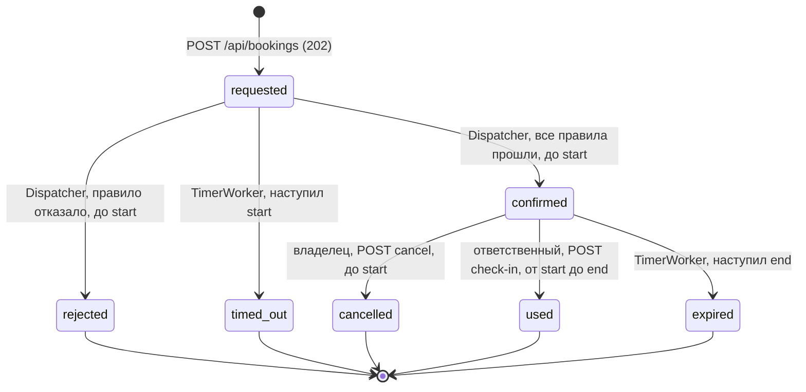

# Состояния Job (брони)

Job — бронь одного ресурса на интервал `[start, end)`. Переходы и условия взяты из [requirements.md](requirements.md),
раздел «Переходы Job». Код состояния — значение поля `status` в [API](api/openapi.yaml).

| Состояние | Код в API | Конечное | Занимает ресурс и лимит |
|---|---|---|---|
| Запрошена | `requested` | нет | нет |
| Подтверждена | `confirmed` | нет | да |
| Отклонена | `rejected` | да | нет |
| Просрочена | `timed_out` | да | нет |
| Отменена | `cancelled` | да | нет |
| Использована | `used` | да | да, до окончания интервала |
| Истекла | `expired` | да | нет |

## Диаграмма

Подписи стрелок: кто выполняет переход и условие на момент сохранения. Все переходы выполняются условным
обновлением в одной транзакции: `UPDATE … SET status = :to WHERE id = :id AND status = :from AND <условие по времени>`.
Если обновление не изменило ни одной строки, перехода нет, письмо в очередь не ставится.

## Разрешённые переходы

| Из | В | Кто | Условие на момент сохранения | Письмо |
|---|---|---|---|---|
| `requested` | `confirmed` | Dispatcher | Все `IBookingRule` вернули `Pass`, время < `start` | Подтверждение |
| `requested` | `rejected` | Dispatcher | Хотя бы одно правило вернуло `Reject`, время < `start` | Отклонение с причиной |
| `requested` | `timed_out` | TimerWorker | Время ≥ `start`, результат проверки не зафиксирован | Нет |
| `confirmed` | `cancelled` | Владелец через API | Время < `start` | Отмена |
| `confirmed` | `used` | Ответственный через API | `start` ≤ время < `end` | Нет |
| `confirmed` | `expired` | TimerWorker | Время ≥ `end` | Истечение |

## Запрещённые переходы и ответ системы

Формат ошибки единый для всего API: `{"error": {"code", "message", "field", "details", "requestId"}}`, см.
`components.schemas.Error` в [openapi.yaml](api/openapi.yaml).

| Попытка | Пример | Ответ системы |
|---|---|---|
| Отменить Job не в `confirmed`: `requested`, `rejected`, `timed_out`, `used`, `expired` | E15 | `409 invalid_state`, `details.currentStatus`, состояние не меняется |
| Отменить `confirmed` при времени ≥ `start` | E12, E21 | `409 cancel_window_closed`, `details.start`, бронь остаётся `confirmed` |
| Повторно отменить уже `cancelled` | E14 | Не переход, а повтор: `200` с текущей бронью, второе письмо не ставится |
| Отметить использование Job не в `confirmed`: `requested`, `rejected`, `timed_out`, `cancelled`, `expired` | E20 | `409 invalid_state`, `details.currentStatus` |
| Отметить использование раньше `start` | E17 | `409 check_in_too_early`, `details.start` |
| Отметить использование при времени ≥ `end` | E18, E22 | `409 check_in_window_closed`, `details.end` |
| Повторно отметить уже `used` | E19 | Не переход, а повтор: `200` с текущей бронью |
| Отменить или отметить чужую либо несуществующую бронь | E13, E16, E23 | `404 booking_not_found`, одинаково для любого состояния: статус не раскрывается |
| Вернуть конечный Job в работу («воскресить») | К5 | В API нет такой операции. Нужна новая бронь через `POST /api/bookings` с новым `Idempotency-Key`. Старый Job и его причина не меняются |
| Повторить `POST /api/bookings` с тем же ключом для конечного Job | E5 | `200` с исходной бронью в её конечном состоянии; новый Job не создаётся |
| `requested` → `confirmed` или `rejected` при времени ≥ `start` | E10 | Внутренний переход без HTTP: условное обновление не проходит, Dispatcher пишет в лог `transition_rejected`; Job переводит в `timed_out` TimerWorker |
| `confirmed` → `rejected` или `timed_out`; `used` → `expired`; `cancelled` → `expired` | S4, S6 | Внутренний переход: таймер и Dispatcher меняют только Job в своём исходном состоянии, обновление ничего не меняет, письмо не ставится |
| Любой переход из конечного состояния | — | Через API — `409 invalid_state` (для владельца или ответственного) или `404 booking_not_found` (для остальных); внутренние — обновление ничего не меняет |

В доменном ядре недопустимый переход даёт `InvalidTransitionException(from, to)`. HTTP-слой переводит его в
`409 invalid_state`, а нарушение временного окна — в соответствующий код `cancel_window_closed`, `check_in_too_early`
или `check_in_window_closed`.
